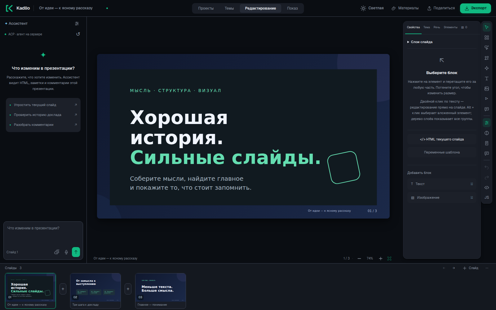
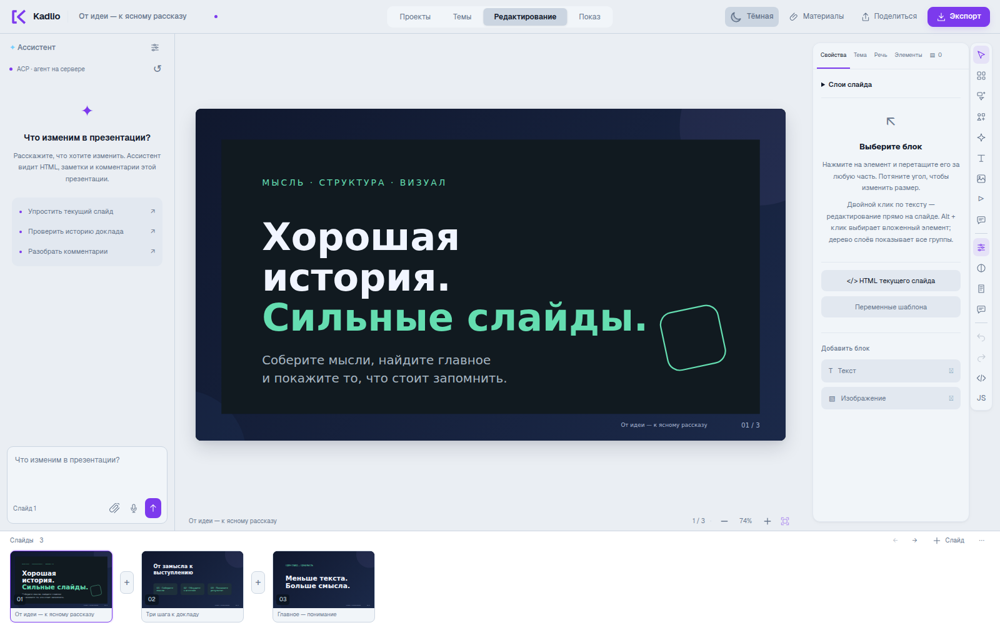
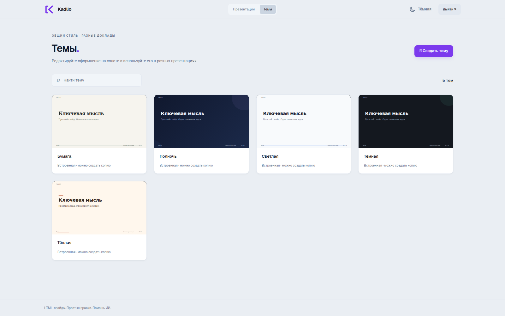

<div align="center">


# Kadlio

**От идеи до презентации — вместе с ИИ.**

Открытый HTML-редактор презентаций с визуальным холстом, чатом с агентом
и экспортом в PowerPoint, PDF и автономный HTML.

[](LICENSE)
[](package.json)
[](#как-запустить)
[](https://t.me/rozum_in_the_loop)

**[Попробовать онлайн: kadlio.pro](https://kadlio.pro)**

[Быстрый запуск](#как-запустить) · [Возможности](#что-внутри) · [Документация](docs/README.md) · [Участие в разработке](CONTRIBUTING.md)

</div>



## Ваша идея. Ваши слайды. Ваш ИИ.

Опишите доклад, добавьте материалы и обсудите с агентом структуру и оформление. Правьте результат прямо на слайде, собирайте комментарии и экспортируйте готовую презентацию.

Каждый слайд — HTML и CSS. Агент может менять конкретный блок, а вы сразу видите результат. Можно двигать элементы мышью, редактировать исходник вручную или сочетать оба подхода.

Kadlio запускается на вашем компьютере или сервере. Вы выбираете ИИ-провайдера и подключаете свой API-ключ либо серверного агента через ACP. Для ручного редактирования ИИ не нужен.

> **Статус: beta.** Сейчас приложение рассчитано на одну установку с одним владельцем. Возможности агента зависят от провайдера; импорт и экспорт сложных PPTX могут потребовать ручной правки.

## Что внутри

| | Возможности |
| --- | --- |
| **Редактор** | HTML-холст, перемещение и оформление элементов, слои, замки, масштаб и редактор исходников. |
| **ИИ рядом** | Чат для презентаций и тем, материалы и изображения в контексте, комментарии в конкретной точке слайда. OpenAI-совместимый API, ACP и MCP. |
| **Оформление** | Визуальное редактирование тем, переменные шаблона, композиции, дизайнерские элементы и SVG-иконки с поиском. |
| **Движение** | Переходы между слайдами, эффекты элементов, видео и пользовательские JS-сниппеты. |
| **Обратная связь** | Речь докладчика, публичная ссылка на просмотр и гостевые комментарии по выбору владельца. |
| **Форматы** | Импорт PPTX. Экспорт в PDF, редактируемый PPTX и автономный HTML. |

### Светлая и тёмная мастерская

Тема интерфейса меняется отдельно от оформления презентации: ваш доклад сохраняет свои цвета и шрифты.



### Один стиль для всего доклада

Выберите готовую тему или создайте свою. Фон, декоративные элементы и переменные редактируются отдельно от содержимого слайдов; библиотека тем доступна для новых презентаций.



Все снимки сделаны в приложении на нейтральной демонстрационной презентации.

---

## Как запустить

Нужны Docker и Docker Compose. Всё остальное, включая браузер для экспорта и конвертер документов, устанавливается в контейнер.

Откройте терминал в папке проекта и выполните следующие шаги.

**1. Создайте файл настроек:**

```sh
cp .env.example .env
```

**2. Откройте `.env` и задайте данные для входа:**

```dotenv
ADMIN_USERNAME=admin
ADMIN_PASSWORD=
```

В строку `ADMIN_PASSWORD` впишите свой пароль длиной от 16 до 256 символов. Логин `admin` тоже можно заменить. Пароль со знаком `$` или `#` заключите в одинарные кавычки, чтобы он читался как обычный текст.

**3. Запустите приложение:**

```sh
docker compose up --build -d
```

При первой сборке Docker скачает зависимости — это может занять несколько минут. Затем откройте [http://127.0.0.1:3210](http://127.0.0.1:3210) и войдите с данными из `.env`.

Аккаунт владельца создаётся автоматически, если база пользователей пустая. При следующих запусках приложение использует уже созданный аккаунт. Изменение `.env` не сбрасывает его пароль и не завершает открытые сессии.

Файл `.env` содержит ваши настройки и пароль. Он исключён из Git и Docker-образа; не публикуйте его вместе с проектом.

## Как сделать первую презентацию

1. На странице проектов нажмите кнопку создания презентации.
2. Введите название и, если хотите, описание доклада.
3. Выберите ручной или умный режим, тему и загрузите материалы.
4. В ручном режиме откроется пустая презентация. В умном агент подготовит вариант на основе вашего описания и файлов; для этого сначала подключите ИИ.
5. Правьте слайды на холсте или в чате. Речь докладчика находится в отдельной панели, комментарий можно поставить прямо в нужную точку слайда.

Если ИИ ещё не подключён, начните с ручного режима и настройте его в чате открывшейся презентации.

Изменения в презентации сохраняются автоматически. В отдельном редакторе темы используйте кнопку сохранения.

## Как подключить ИИ

Откройте настройки чата и выберите один из двух вариантов:

- **OpenAI-совместимый API.** Укажите адрес сервиса, модель и API-ключ. Поддерживаются Responses и Chat Completions; работа с изображениями и инструментами зависит от выбранного сервиса и модели.
- **ACP.** Подключите серверного агента, например Codex. Адаптер входит в поставку, а авторизацию своего аккаунта нужно передать отдельно. [Инструкция по настройке](docs/docker.md#acp-и-приватная-авторизация).

Агент может читать HTML, менять слайды и темы, работать с материалами и смотреть изображения результата. Доступ к редактору он получает через MCP-инструменты приложения. Модели не предоставляются команды управления сервером.

API-ключ хранится на сервере и не возвращается браузеру. Подробности для разработчиков: [подключение провайдеров](docs/providers.md), [границы доступа агента](docs/agent-boundary.md).

## Комментарии и совместный просмотр

Кнопка «Поделиться» создаёт ссылку на просмотр. Редактировать презентацию по ней нельзя. Отдельно можно разрешить гостям читать речь докладчика и оставлять комментарии.

Гостевые отзывы сначала приходят владельцу. Агент получает их только после вашего одобрения; отправка сообщения агенту — отдельное действие. [Подробнее о публичных ссылках](docs/sharing.md).

## Экспорт

- **PDF** — готовые статичные слайды для просмотра и отправки.
- **PPTX** — презентация для PowerPoint или передачи дизайнеру. Поддерживаемый текст и простые фигуры остаются редактируемыми; сложные CSS/SVG-элементы могут стать изображениями или выглядеть иначе.
- **HTML** — отдельный файл для показа в браузере без интернета. Сохраняет поддерживаемые эффекты; личная речь, комментарии, материалы и история чата в него не входят.

PDF и PPTX не выполняют JavaScript. Видео экспортируется кадром или обложкой, а пользовательские JS-переходы не превращаются в анимации PowerPoint. Перед выступлением проверьте экспорт в той программе, в которой будете его показывать.

[Импорт PPTX](docs/pptx-import.md) · [Видео и эффекты](docs/presentation-runtime.md)

## Где хранятся данные

Docker сохраняет презентации, темы, материалы, историю чата и базу пользователей в отдельном томе `presentation-data`. Пересборка приложения и обычная остановка сохраняют эти данные.

Посмотреть журнал работы:

```sh
docker compose logs --tail=100 presentations
```

Остановить приложение:

```sh
docker compose down
```

Запустить снова:

```sh
docker compose up -d
```

**`docker compose down -v` удаляет том и все данные приложения.** Для обычной остановки эта команда не нужна.

Как поменять пароль существующего владельца, настроить свой домен, подключить авторизацию Codex и сделать резервную копию: [руководство по установке](docs/docker.md).

## Для разработчиков

Это один Node.js-сервис с отдельными каталогами backend, frontend и shared. Движок отвечает за презентации, темы и HTML; модули подключают ИИ, MCP, импорт и экспорт. Композиции, элементы, иконки и анимации оформлены как дополнения с явными точками подключения.

Начать знакомство с кодом:

- [Архитектура](docs/architecture.md) и [карта модулей](docs/modules.md).
- [Как добавить ИИ-провайдера](docs/providers.md).
- [Как добавить дополнение](docs/addons.md).
- [Как устроено хранение](docs/storage.md).
- [Проверки и участие в разработке](CONTRIBUTING.md).

Остальные инструкции собраны в [docs](docs/README.md). Правила безопасности — в [SECURITY](SECURITY.md).

## Автор и новости

Развиваю Kadlio и рассказываю о работе с ИИ, агентами и своих проектах в Telegram: **[Rozum in the Loop](https://t.me/rozum_in_the_loop)**.

Если нашли ошибку или хотите предложить улучшение, начните с [правил участия](CONTRIBUTING.md). Для сообщений об уязвимостях есть отдельные [правила безопасности](SECURITY.md).

## Лицензия

Проект распространяется под [MIT](LICENSE). Использованные библиотеки, шрифты и части SlideForge/OpenScreen сохраняют свои лицензии и указание авторства: [THIRD_PARTY_NOTICES](THIRD_PARTY_NOTICES.md).
