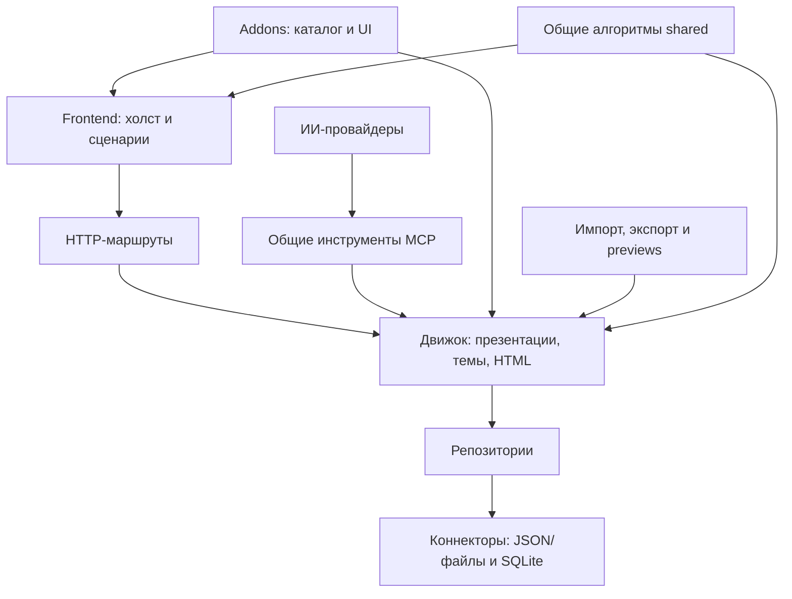

# Архитектура

Приложение состоит из одного Node.js-сервиса и frontend на обычных ES-модулях. Backend и frontend разделены каталогами и ответственностью; дополнительные сервисы, frontend-сборка и второй формат сцены не нужны. HTML/CSS остаётся источником презентации.

Это модульный монолит со слоистой архитектурой. Используются обычные паттерны: Repository для хранения, Adapter для внешних протоколов и форматов, Strategy для выбора ИИ-провайдера и Facade для совместимого API движка. Composition root собирает зависимости явно через конструкторы и параметры. Абстракции вводятся на существующих границах, без контейнера зависимостей, шины событий или универсального plugin framework.

## Основные слои

**Движок** владеет объектами презентаций, слайдов и тем, правилами допустимого HTML/оформления, стабильными ID и изменениями с проверкой версии. Библиотека проектов собирает эти операции в существующий API приложения. Изображения, CSS и код слайда остаются связаны с этим объектом; тема применяется независимым снимком.

**Хранение** выделяет коннекторы и репозитории для SQLite, метаданных, снимков и очередей записи. Все SQL-запросы пользователей/сессий находятся в auth-репозитории. Презентации продолжают храниться в JSON/HTML/CSS-файлах. Многофайловые операции со слайдами, CSS и assets пока координирует сервис движка, в том числе через fs: существующий алгоритм сохранён без нового универсального слоя хранения. Рефакторинг не мигрирует данные и не превращает весь проект в SQLite.

**Модули** решают отдельные сценарии: ИИ-чат, MCP, импорт, экспорт, визуальные previews, загрузки и публичные ссылки. Провайдер не пишет HTML сам: он вызывает тот же инструментарий движка и получает те же ошибки версии.

**Frontend** делит холст и работу с HTML, сценарии редактора и UI дополнений. Контроллеры координируют сохранение, выбор, чат, аннотации и навигацию. Цветовая тема приложения независима от оформления презентации.

**Shared** содержит одинаковые для браузера и Node алгоритмы оформления, timeline, каталоги и runtime дополнений. Здесь нет Node I/O, HTTP-запросов к провайдеру или доступа к секретам.

## Явная сборка

Точка запуска `backend/main.js` читает конфигурацию и запускает HTTP-сервер. Сборка в `backend/application/index.js` подключает движок и модули, получающие зависимости явно. `backend/application/engine.js` сохраняет прежний фасад Library и подключает addons к PresentationEngine. `frontend/app.js` управляет SPA-навигацией и жизненным циклом экранов; `frontend/editor.js` монтирует контроллеры, холст и UI дополнений. Подробности — в [руководстве по SPA](spa.md).

Реестры провайдеров и addons — небольшие списки с проверкой ID и обязательных методов. Они не ищут файлы автоматически, не исполняют код из загруженных документов и не загружают plugins с сети. Добавление модуля — изменение явной точки подключения и проверка его контракта.

Старые `src/server.js`, `src/user-cli.js` и `src/mcp/server.js` сохранены как совместимые точки запуска для существующей поставки. Логика находится в `backend/`.

## Границы изменения

- UI, HTTP и MCP проходят через общие операции движка.
- Репозиторий читает текущую версию перед изменением; конфликт возвращается вызывающему, а не скрывается повторной записью.
- Состояние показа и анимации не сериализуется обратно в HTML.
- Библиотечная тема и каталог addon — исходники; применённые экземпляры являются независимыми снимками.
- Ручной черновик не отбрасывается из-за SSE-события или ответа агента.
- Публичная ссылка не даёт доступа к аккаунту, ИИ-настройкам, материалам или операциям редактирования.
- Гостевой отзыв не становится контекстом агента до явного решения владельца.

## Дополнения

Сейчас подключены композиции, дизайнерские элементы, иконки и анимации. В их описании есть `targets` — например `slide`, `timeline`, `project` — и `capabilities`, такие как вставка, каталог, поиск или runtime. Это описание области дополнения, а не новый универсальный формат данных.

UI дополнения может иметь панель/кнопки, получать выбранный слайд и презентацию и применять изменения через контекст редактора. Сохранение остаётся общим. JS, выполняемый внутри презентации, подчиняется изоляции runtime; он не получает возможности Node-сервера или приложения.

[Пример addon](addons.md) показывает подключение панели и обычного HTML-элемента. Для будущего 3D или интерактивного блока потребуется отдельный адаптер и его ограничения экспортов; рефакторинг их не реализует.

## Доверие и безопасность

Слайды, темы, документы и комментарии являются содержимым, а не разрешением выполнять команды. ИИ-провайдеры получают только зарегистрированные инструменты с привязкой к проекту/теме. ACP-клиент автоматически отклоняет нативные и неизвестные запросы разрешений; отдельные HOME/CODEX_HOME не наследуют конфигурацию оператора.

Произвольный операторский ACP executable не становится безопасным только от регистрации: он выполняется с правами пользователя сервиса. Сервис запускается отдельно от оператора; контейнер — под non-root пользователем, без Docker socket и host-каталогов приложения.

JS слайда исполняется только в opaque iframe с `sandbox="allow-scripts"`, без same-origin и сети. Сохранение проверяет синтаксис, не исполняя код на Node. Конвертер Office ограничен bubblewrap и фильтром сети; fallback без sandbox отсутствует.

Подробности: [хранение](storage.md), [провайдеры](providers.md), [граница ACP](agent-boundary.md), [runtime](presentation-runtime.md), [SECURITY](../SECURITY.md).
